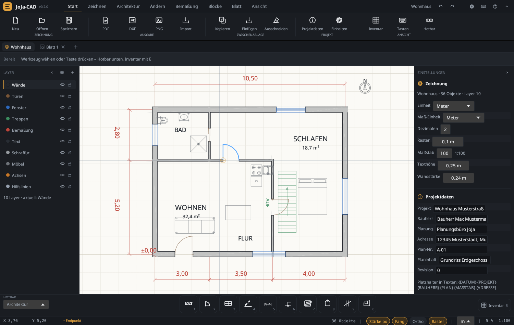

# JoJa-CAD

[Deutsch](README.md) · **English**

**2D CAD for architecture and building-permit drawings.** Deliberately minimal,
free and open source — for Linux and Windows.



*Example drawing from the repository — a placeholder, not professionally reviewed.*

## The idea

A building-permit drawing does not need a 3D modelling suite with a thousand
tools. It needs a clean tool for floor plans, dimensions and sheets — and
nothing else.

- **Focused on permit drawings**: walls with openings, dimensions to German DIN
  standards, sheets with frame and title block, line weights that match the print.
- **Deliberately minimal**: only what a submission drawing needs. No 3D, no BIM,
  no IFC, no DWG.
- **Free and open source** (GPL-3.0-or-later), open file format (JSON), no cloud, no account.
- **Linux and Windows.** macOS is planned.
- **German interface**, switchable to English, further languages possible.
- **Fully controllable by AI** through an MCP server.

## Main features

| | |
|---|---|
| **Primitives** | point, line, polyline, rectangle, circle, arc, ellipse, hatch, text |
| **Architecture** | wall with openings, door, window, stair, volume — the parts connect dynamically: mitres at junctions, openings cut the wall, doors sit on the leaf side |
| **Dimensions** | single dimension, dimension chain, plan and section level marks per DIN 406/1356; dimension text in mm/cm/m |
| **Blocks** | system library (sanitary, kitchen, furniture, symbols) and your own project blocks, extensible |
| **Exchange** | import and export of PDF, PNG and DXF |
| **AI control** | MCP server with 10 tools, fully headless, including image responses |

## Note: this project is entirely AI-generated

The entire source code was generated by an AI — not a single line was typed by
hand. The development process was reshaped so that it essentially consists of
describing features and bugs. The code was developed with Hermes Agent and the
model DeepSeek V4.1 Flash 1017. Human involvement was limited to making
decisions, testing the running program and criticising defects.

The project started as an experiment to see how far AI-generated programming
carries. The code grew so fast that a detailed review is impossible — what
exactly ended up in the program therefore cannot be fully known. AI-generated
code is rightly controversial. Testing happened only at the level of ordinary
use; using this program therefore requires trusting the correctness of
AI-generated code.

## Installation

**There are no finished packages yet.** The project is at version 0.2; the
installation is planned for 1.0. Until then, anyone who wants to try it builds
from source (see below).

### Linux *(placeholder)*

Planned: AppImage or .deb via GitHub Releases.

### Windows *(placeholder)*

Planned: installer or portable ZIP via GitHub Releases.

## Repository layout

```text
JoJa-CAD/
├── crates/
│   ├── jjcad-core/     geometry, model, renderer, actions, PDF/DXF/PNG (no GUI)
│   ├── jjcad-gui/      desktop application (egui/eframe)
│   └── jjcad-mcp/      MCP server over stdio
├── docs/               architecture, file format, commands, MCP, usage, status
├── samples/            example drawings, PDF, PNG, DXF (placeholders)
└── scripts/            helper scripts (headless start, screenshot, roundtrip test)
```

## Where the data lives

All user data lives in **one** folder: `prefs.json`, `sitzung.json` (session),
`blocks/` (user blocks), `sicherungen/` (backups) and `log/`. Drawings stay
where you save them — the program does not create anything in their folder.

The folder is determined by the first matching entry:

1. `jjcad --daten-dir <path>`
2. the environment variable `JJCAD_DATA_DIR`
3. a file `portable.txt` next to the program → `<program folder>/data`
4. the platform default:
   - Linux `$XDG_DATA_HOME/JoJa-CAD`, otherwise `~/.local/share/JoJa-CAD`
   - Windows `%APPDATA%\JoJa-CAD`
   - macOS `~/Library/Application Support/JoJa-CAD`

On first start an existing `prefs.json` from the old location (`~/.config/jjcad`)
is copied into the new folder; the old file stays where it is. The three
subfolders can be changed under Settings → Storage locations (relative to the
data folder or absolute; each field has a "Reset"). If an instance is already
running on the same folder, it takes over the work: a drawing opened from
outside appears as a tab in the running window, and a start without a file just
brings it to the front. For separate work, use a different data folder
(`--daten-dir`).

## Documentation

The documentation is written in German, the language of the interface.

- [`docs/BEDIENUNG.md`](docs/BEDIENUNG.md) — tools, panels, first steps
- [`docs/ARCHITEKTUR.md`](docs/ARCHITEKTUR.md) — structure, data flow, decisions
- [`docs/FORMAT.md`](docs/FORMAT.md) — `.jjcad` file format (JSON, open)
- [`docs/SICHERUNG.md`](docs/SICHERUNG.md) — autosave and retention: settings, guarantees, rules
- [`docs/BEFEHLE.md`](docs/BEFEHLE.md) — every action with its parameters
- [`docs/MCP.md`](docs/MCP.md) — AI control, tools, examples
- [`docs/GLOSSAR.md`](docs/GLOSSAR.md) — terms, binding for interface and code
- [`docs/STATUS.md`](docs/STATUS.md) — current state and open points
- [`docs/WAYLAND-DATEI-DROP.md`](docs/WAYLAND-DATEI-DROP.md) — why file drop does not work under Wayland and when it returns
- [`docs/BEKANNTE-GRENZEN.md`](docs/BEKANNTE-GRENZEN.md) — known limits that cannot be solved right now (and what would solve them)
- [`docs/VERSIONEN.md`](docs/VERSIONEN.md) — versioning, release process, the way to 0.3
- [`CHANGELOG.md`](CHANGELOG.md) — what changed in each version

## License

GPL-3.0-or-later — full text in [`LICENSE`](LICENSE). Whoever passes JoJa-CAD on, passes it on under the same license.

## Building

Rust 1.88 or newer (`rustup`). Tested is the Linux build (X11 and Wayland); on
Debian/Ubuntu additionally:

```bash
sudo apt install libxkbcommon-dev libwayland-dev libx11-dev libgl1-mesa-dev
```

```bash
cargo run --release -p jjcad-gui   # start the application
cargo test
```

## Contributing

No commits or pull requests are accepted. With AI-generated code a classic code
review is too expensive and would slow the development process down. Bug reports
and feature requests as GitHub issues are welcome instead: since implementation
happens through prompts, a prompt review is far easier than a code review, and
submitted proposals are implemented in the project's own workflow with its own
AI agent.

**How to submit:**

1. Open an issue on GitHub and pick the matching template (bug report or feature
   request).
2. Describe the matter the way you would give it to an agent: as a direct
   instruction with a clear goal, not as a discussion.
3. Stick to the same structure:
   - **Current state**: what does the program do right now? How can the
     behaviour be reproduced?
   - **Defect or problem**: what is wrong or insufficient about it? (For feature
     requests: what can the program not do yet that it should?)
   - **Target state**: how should it behave instead? What exactly should the
     agent do?

The more precisely an issue describes these three points, the more likely it can
be taken over directly as a prompt. Important terms are defined in
[`docs/GLOSSAR.md`](docs/GLOSSAR.md).

Forking and building on it yourself is expressly permitted by the GPL;
the GitHub project also contains the required [`AGENTS.md`](AGENTS.md) so that
work can continue directly with another agent.
