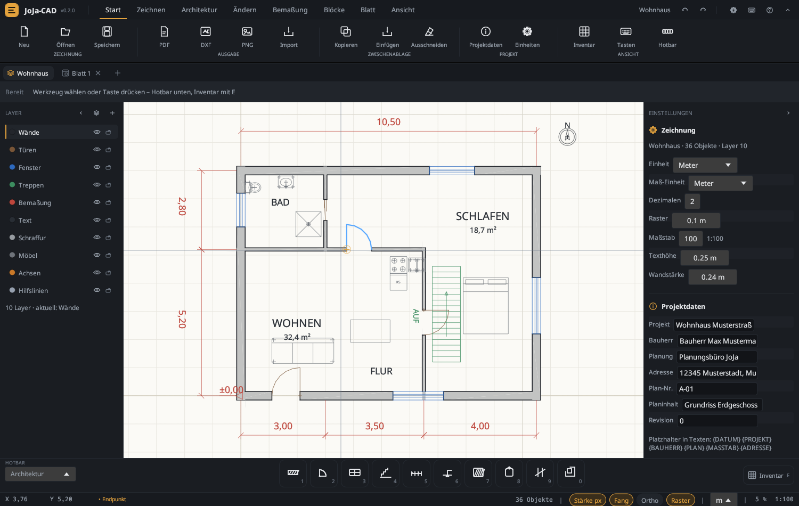
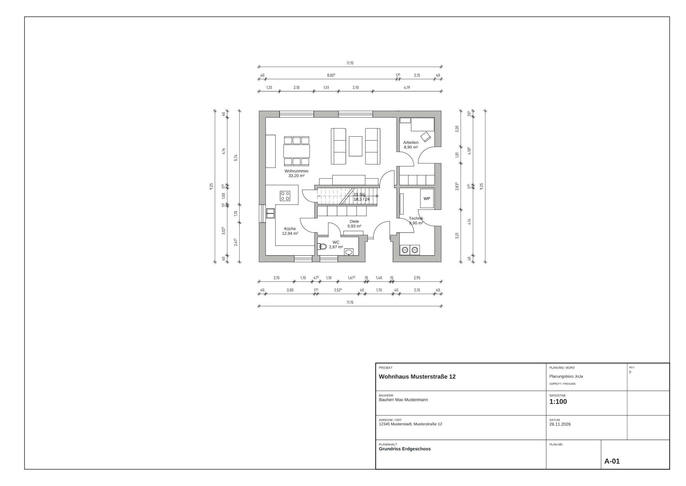

# JoJa-CAD

**Deutsch** · [English](README.en.md)

**2D-CAD für Architektur- und Bauantragszeichnungen.** Kostenlos und quelloffen —
für Linux, Windows und macOS.



*Beispielzeichnung aus dem Repository: Wohnhaus, Erdgeschoss.*



*Die Beispielzeichnung als gesetztes Blatt A3 mit Rahmen, Schriftfeld und Ansichtsfenster.*

## Die Idee

JoJa-CAD ist ein vollständiges 2D-CAD-Programm mit Fokus auf Architektur und
Bauantragszeichnungen. Kostenlos und quelloffen — für Linux, Windows und macOS.

- **Fokus auf Architektur und Bauanträgen**: JoJa-CAD ist auf Zeichnungen für
  Bauanträge ausgerichtet — Wände mit Öffnungen, Bemaßung nach DIN, Blätter mit
  Rahmen und Schriftfeld, Linienstärken wie im Druck. Weitere Bereiche wie
  Maschinenbau, Bauingenieurwesen und Vermessungstechnik sind als spätere
  Erweiterungen geplant; Vorschläge dazu sind willkommen.
- **Bewusst minimal**: nur das, was eine Bauvorlage braucht. Kein 3D, kein BIM,
  kein IFC, kein DWG.
- **Kostenlos und quelloffen** (GPL-3.0-or-later), offenes Dateiformat (JSON), keine Cloud,
  kein Konto.
- **Linux, Windows und macOS.** Die macOS-Fassung ist noch ungeprüft.
- **Oberfläche auf Deutsch**, auf Englisch umstellbar, weitere Sprachen möglich.
- **Vollständig über KI steuerbar** durch einen MCP-Server.

## Projektstatus

JoJa-CAD befindet sich in der frühen Phase der Version 0.2. Ziel ist es,
möglichst schnell neue Features hinzuzufügen. Neue Features werden nur wenig
getestet, Fehler sind möglich. Der Bereich der Bauzeichnungen soll mit Version
0.3 vollständig sein. Ein stabiler Release-Zyklus ist erst mit Version 1.0
geplant, die für Ende Q1 2027 vorgesehen ist.

## Wichtigste Funktionen

| | |
|---|---|
| **Grundelemente** | Punkt, Linie, Polylinie, Rechteck, Kreis, Bogen, Ellipse, Schraffur, Text |
| **Architektur** | Wand mit Öffnungen, Tür, Fenster, Treppe, Volumen — die Bauteile verbinden sich dynamisch: Gehrung an Anschlüssen, Öffnungen schneiden die Wand, Türen sitzen auf der Blattseite |
| **Bemaßung** | Einzelmaß, Maßkette mit Höhenangaben, Radius, Grundriss- und Schnitt-Kote nach DIN 406/1356; Maßtext in mm/cm/m |
| **Blöcke** | Systembibliothek (Sanitär, Küche, Möbel, Symbole) und eigene Projektblöcke, erweiterbar |
| **Austausch** | Import und Export von PDF, PNG und DXF möglich |
| **KI-Steuerung** | MCP-Server mit 10 Werkzeugen, vollständig headless, inklusive Bild-Rückgabe |

## Hinweis: dieses Projekt ist vollständig KI-generiert

Der gesamte Sourcecode wurde von einer KI generiert — keine Zeile wurde von Hand getippt. Der Entwicklungsprozess wurde so umgestaltet, dass er im Wesentlichen nur noch aus dem Beschreiben von Features und Bugs besteht. Der Code wurde mit Hermes Agent und dem Modell DeepSeek V4.1 Flash 1017 entwickelt. Die menschliche Beteiligung beschränkte sich auf das Treffen von Entscheidungen, das Testen des laufenden Programms und die Kritik von Fehlern.

Dieses Projekt ist als Experiment entstanden, um zu sehen, wie weit KI-generierte Programmierung trägt. Der Code ist so schnell gewachsen, dass eine Prüfung im Detail unmöglich ist — was genau im Programm eingebaut wurde, lässt sich daher nicht vollständig wissen. KI-generierter Code ist zu Recht umstritten. Getestet wurde ausschließlich auf oberflächlicher Nutzungsebene; die Nutzung setzt folglich Vertrauen in die Korrektheit des KI-generierten Codes voraus.

## Installation

Fertige Pakete liegen bei den **[Releases](../../releases)** — entpacken bzw.
starten, keine Installation, keine Administratorrechte, kein Konto.

### Linux

**AppImage** (empfohlen, eine Datei):

```bash
chmod +x JoJa-CAD-0.2.5-x86_64.AppImage
./JoJa-CAD-0.2.5-x86_64.AppImage
```

Wer mehrere AppImages verwaltet, bindet sie am besten mit
[Gear Lever](https://github.com/mijorus/gearlever) ein: es legt die
Startmenü-Verknüpfung an, aktualisiert beim neuen Release und hält die Dateien
an einem Ort statt im Download-Ordner. Startet ein System ohne FUSE die Datei
nicht, hilft `./JoJa-CAD-0.2.5-x86_64.AppImage --appimage-extract-and-run`.

**Tar-Archiv** (wenn du die Dateien lieber offen im Ordner hast): entpacken und
`./jjcad` starten. Die Schriften liegen im Ordner `fonts/` neben dem Programm.

Der **MCP-Server** steckt in beiden Linux-Paketen mit: im AppImage über
`--mcp` (z. B. `./JoJa-CAD-0.2.5-x86_64.AppImage --mcp --selftest`), im
Tar-Archiv als eigene Datei `jjcad-mcp`.

### Windows

**Portables ZIP**: entpacken (beliebiger Ordner, USB-Stick genügt) und
`jjcad.exe` starten. Keine Installation, keine Registry, keine
Administratorrechte; der Ordner darf beliebig verschoben werden. Die Schriften
stecken in der `.exe`, ein Ordner `fonts/` daneben ist nicht nötig;
`SCHRIFTEN-LIZENZ.txt` daneben nennt ihre Lizenz (SIL OFL 1.1).

#### Wenn Windows warnt

Die `jjcad.exe` ist **nicht signiert** (eine Code-Signatur setzt ein Zertifikat
mit geprüfter Identität voraus). Deshalb stufen SmartScreen und Defender eine
frisch heruntergeladene Datei als unbekannt ein. Drei Wege, je nach Meldung:

1. **SmartScreen** („Windows hat den Start dieser App verhindert"): auf
   **„Weitere Informationen"** klicken, dann auf **„Trotzdem ausführen"**.
2. **Defender meldet einen Fund**: im Schutzverlauf **„Zulassen"** bzw.
   **„Zulassen auf dem Gerät"** wählen — oder den Programmordner unter
   Viren- & Bedrohungsschutz → Einstellungen → Ausschlüsse eintragen.
3. **Am saubersten vorher entsperren**: Rechtsklick auf die **ZIP-Datei** →
   **Eigenschaften** → unten im Abschnitt „Sicherheit" das Kästchen
   **„Entsperren"** anhaken → Übernehmen → *danach* entpacken. Die Freigabe gilt
   dann für alles im Archiv. Die einzelne `.exe` hat dasselbe Kästchen unter
   Eigenschaften → Allgemein („Die Datei stammt von einem anderen Computer …").

### macOS (ungeprüft)

Die Fassung ist gebaut, aber noch nicht ausprobiert — Rückmeldung ist willkommen.
Zwei Pakete: `macos-arm64` für Apple Silicon, `macos-x64` für Intel-Rechner.

```bash
unzip JoJa-CAD-0.2.5-macos-arm64.zip
xattr -dr com.apple.quarantine JoJa-CAD-0.2.5.app
open JoJa-CAD-0.2.5.app
```

Das Programm ist **nicht signiert und nicht notarisiert** (dafür braucht es ein
Apple-Developer-Konto), deshalb blockiert macOS den ersten Start. Der
`xattr`-Befehl hebt die Quarantäne auf; alternativ Rechtsklick auf das Programm →
„Öffnen" → „Öffnen". Der MCP-Server liegt als
`JoJa-CAD-0.2.5.app/Contents/MacOS/jjcad-mcp` daneben, die Schriften unter
`Contents/MacOS/fonts/`.

Wer selbst bauen will: siehe [Entwickeln](#entwickeln).

## Aufbau des Repositories

```text
JoJa-CAD/
├── crates/
│   ├── jjcad-core/     Geometrie, Modell, Renderer, Aktionen, PDF/DXF/PNG (GUI-frei)
│   ├── jjcad-gui/      Desktop-Anwendung (egui/eframe)
│   └── jjcad-mcp/      MCP-Server über stdio
├── docs/               Architektur, Dateiformat, Befehle, MCP, Bedienung, Stand
├── samples/            Beispielzeichnungen und Bilder der README, PDF, DXF
└── scripts/            Hilfsskripte (headless starten, Screenshot, Roundtrip-Test)
```

## Wo die Daten liegen

Alle Nutzdaten liegen in **einem** Ordner: `prefs.json`, `sitzung.json`,
`blocks/` (Benutzerblöcke), `sicherungen/` und `log/`. Zeichnungen bleiben, wo
Sie sie speichern — das Programm legt in deren Ordner nichts an.

Den Ordner bestimmt die erste zutreffende Angabe:

1. `jjcad --daten-dir <Pfad>`
2. die Umgebungsvariable `JJCAD_DATA_DIR`
3. eine Datei `portable.txt` neben dem Programm → `<Programmordner>/data`
4. der Plattformstandard:
   - Linux `$XDG_DATA_HOME/JoJa-CAD`, sonst `~/.local/share/JoJa-CAD`
   - Windows `%APPDATA%\JoJa-CAD`
   - macOS `~/Library/Application Support/JoJa-CAD`

`portable.txt` ist der **einzige** Schalter zwischen portabel und installiert:
liegt die Datei neben dem Programm, bleibt alles im Programmordner (`data/`);
fehlt sie, geht alles in den Plattformstandard.

- **Tar-Archiv, Windows-ZIP und macOS-Bündel** liefern die Datei mit — die Daten
  bleiben im Programmordner, und die Datei darf nicht gelöscht werden.
- **Das AppImage** bringt sie nicht mit: sein Inhalt ist schreibgeschützt, also
  liegen die Daten im Plattformstandard (`~/.local/share/JoJa-CAD`). Ein anderer
  Ort geht über `--daten-dir`.

Ein portabler Lauf übernimmt **keine** Einstellungen vom Rechner, an dem er
steckt.

Beim ersten Start einer installierten Fassung wird eine vorhandene `prefs.json`
aus dem alten Ort (`~/.config/jjcad`) in den neuen Ordner kopiert; die alte
Datei bleibt liegen.
Die drei Unterordner lassen sich unter Einstellungen → Speicherorte ändern
(relativ zum Datenordner oder absolut; jedes Feld hat ein „Zurücksetzen“). Läuft bereits
eine Instanz auf demselben Ordner, übernimmt sie die Arbeit: eine von außen
geöffnete Zeichnung erscheint als Reiter im laufenden Fenster, ein Start ohne
Datei holt es nur nach vorn. Für getrennte Arbeit einen anderen Datenordner
angeben (`--daten-dir`).

## Dokumentation

Die Dokumentation ist nach **Leser** sortiert, nicht nach Thema — sonst sucht
jeder in der falschen Datei:

| Ordner | Für wen | Inhalt |
|---|---|---|
| [`docs/benutzer/`](docs/benutzer/) | Anwender | Bedienung, Tastenbelegung, Sicherung, Glossar, bekannte Grenzen |
| [`docs/technik/`](docs/technik/) | Entwickler und Agenten | Architektur, Dateiformat, Befehlsreferenz, MCP, Übersetzungen, Release-Ablauf |
| [`docs/wissen/`](docs/wissen/) | wer verstehen will, *warum* | Herleitungen und Messungen: Wandgehrung, Bogenglättung, Dämmungsschlaufen, PDF-Import, Wayland-Befund |

`docs/wissen/` ist der Teil, der über den Quelltext hinausgeht: dort steht, wie
ein Problem gelöst wurde, welche Variante verworfen wurde und mit welcher Messung
die Lösung belegt ist. Einstieg und Regeln für alle drei Bereiche:
[`docs/README.md`](docs/README.md).

Die wichtigsten Dateien:

- [`docs/benutzer/BEDIENUNG.md`](docs/benutzer/BEDIENUNG.md) — Werkzeuge, Panels, erste Schritte
- [`docs/benutzer/SICHERUNG.md`](docs/benutzer/SICHERUNG.md) — Autosave und Aufbewahrung: Einstellungen, Zusagen, Regeln
- [`docs/benutzer/GLOSSAR.md`](docs/benutzer/GLOSSAR.md) — Begriffe, verbindlich für Oberfläche und Code
- [`docs/benutzer/BEKANNTE-GRENZEN.md`](docs/benutzer/BEKANNTE-GRENZEN.md) — bekannte Grenzen und was sie lösen würde
- [`docs/technik/ARCHITEKTUR.md`](docs/technik/ARCHITEKTUR.md) — Aufbau, Datenfluss, Entscheidungen
- [`docs/technik/FORMAT.md`](docs/technik/FORMAT.md) — Dateiformat `.jjcad` (JSON, offen)
- [`docs/technik/BEFEHLE.md`](docs/technik/BEFEHLE.md) — alle Aktionen mit Parametern
- [`docs/technik/MCP.md`](docs/technik/MCP.md) — KI-Steuerung, Werkzeuge, Beispiele
- [`CHANGELOG.md`](CHANGELOG.md) — was sich je Version geändert hat

## Lizenz

GPL-3.0-or-later — vollständiger Text in [`LICENSE`](LICENSE). Wer JoJa-CAD weitergibt, gibt es unter derselben Lizenz weiter.

## Entwickeln

Rust 1.88 oder neuer (`rustup`). Getestet ist der Linux-Build (X11 und Wayland);
unter Debian/Ubuntu zusätzlich:

```bash
sudo apt install libxkbcommon-dev libwayland-dev libx11-dev libgl1-mesa-dev
```

```bash
cargo run --release -p jjcad-gui   # Anwendung starten
cargo test
```

## Beitragen

Jegliche Form der Unterstützung ist willkommen: Fehlerberichte, Feature-Wünsche,
Kritik am Projekt sowie Feedback und Reviews aus der Benutzung. Commits und Pull
Requests werden nicht angenommen, weil bei KI-generiertem Code eine klassische
Code-Review nicht passt; stattdessen werden die Meldungen als Prompt übernommen
und im eigenen Ablauf mit dem KI-Agenten umgesetzt. Details: siehe
[`CONTRIBUTING.md`](CONTRIBUTING.md).
