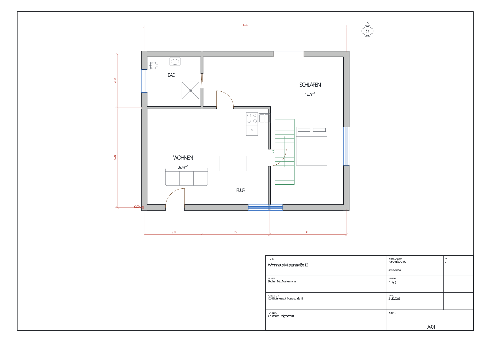

# JoJa-CAD

**2D-CAD für Architektur und Bauantragszeichnungen** — bewusst minimal, DIN-orientiert,
in Rust geschrieben, mit headless MCP-Schnittstelle für KI-Agenten.

> Version 0.2 · Diese Fassung ist eine Neuentwicklung des Kerns und der Oberfläche.


*Grundriss mit Wänden, Öffnungen, Treppe, Bemaßung und Möbelblöcken — links die
Layer, rechts die Eigenschaften, unten die Item-Slot-Hotbar.*



## Was JoJa-CAD kann

| Bereich | Funktionen |
|---|---|
| **Grundelemente** | Punkt, Linie, Polylinie, Rechteck, Kreis, Bogen, Ellipse, Schraffur, Text |
| **Architektur** | Wand (mit Dicke, Öffnungen, Anschlüssen), Tür (Dreh-/Schiebe-/zweiflügelig/Öffnung), Fenster, Treppe — parametrisch und mit Linien-Werkzeugen bearbeitbar |
| **Bemaßung** | Einzelmaß, Maßkette, Höhenkote — DIN 406/1356, Schrägstrich- oder Pfeilmarken, Maßtext in mm/cm/m |
| **Blöcke** | Systembibliothek (Sanitär, Küche, Möbel, Symbole), Projektblöcke aus Auswahl, Instanzen mit Rotation/Spiegelung, Zerlegen, ByBlock/ByLayer |
| **Bearbeiten** | Verschieben, Kopieren, Drehen, Spiegeln, Skalieren, Versetzen (Offset), Stutzen, Verlängern, Löschen, Zerlegen, Pipette, Undo/Redo |
| **Fangen** | Endpunkt, Mittelpunkt, Zentrum, Schnittpunkt, Lot, nächster Punkt, Raster, Ortho, Polar (45°-Schritte, rastet nur innerhalb von ±6° — beides einstellbar) |
| **Ebenen** | Farbe, Linienstärke, Linientyp, Sichtbarkeit, Sperre, Druckbarkeit |
| **Blätter** | A4–A0, Rahmen, Schriftfeld (DIN 6771 angelehnt), mehrere Ansichtsfenster mit eigenem Maßstab |
| **Ausgabe** | PDF (vektoriell, mit Schriftfeld), DXF (R12, Import + Export), PNG (headless) |
| **Bedienung** | kompakter Ribbon (einklappbar), Zeichnungs-/Blattreiter, Hotbar (1–0) mit Vorlagen-Dropdown, Inventar (E), Layer- und Eigenschaften-Panel (beide einklappbar), Tastatur-Editor |
| **KI-Steuerung** | MCP-Server mit 10 Werkzeugen, vollständig headless, inkl. Bild-Rückgabe |

## Schnellstart

```bash
cargo run --release -p jjcad-gui            # Anwendung starten
cargo run --release -p jjcad-gui -- datei.jjcad
cargo run -p jjcad-mcp -- --selftest        # Kern + Exporte prüfen
cargo run -p jjcad-mcp                      # MCP-Server auf stdio
cargo test                                  # 25 Tests
```

Die Beispielwohnung inklusive PDF/DXF/PNG liegt in `samples/` und lässt sich mit
`cargo run -p jjcad-core --example demo_plan -- samples` neu erzeugen.

Für Screenshots und automatisierte UI-Tests lässt sich ein Startzustand setzen:
`JJCAD_DEMO_UI=arch,inventar,blatt ./target/release/jjcad` (siehe `apply_demo_ui`).

## Bedienung in 60 Sekunden

1. **Wand** (`G`): Start- und Endpunkt klicken — die Wand läuft als Kette weiter, `ESC` beendet.
2. **Tür** (`H`) / **Fenster** (`J`): in eine Wand klicken. Öffnung, Laibungen und Anschlag
   entstehen automatisch, die Tür richtet sich an der Wand aus.
3. **Maß** (`M`): zwei Punkte und die Maßlinie setzen. **Maßkette**: Punkte klicken, `Enter` beendet.
4. **Hotbar**: Tasten `1`–`0`. Aktives Werkzeug + Klick auf einen leeren Slot verknüpft es.
   Rechtsklick auf einen Slot: Leeren / Verknüpfen / Bearbeiten. Mittlere Taste leert.
5. **Inventar** (`E`): Lager, Blockbibliothek und alle Funktionen — per Drag & Drop auf die Hotbar.
6. **Navigieren**: Mausrad zoomt, mittlere Taste oder `Leertaste`+Ziehen schwenkt, `W A S D` ebenfalls.
7. **Länge tippen**: nach dem ersten Klick Ziffern eingeben, `Enter` übernimmt den Abstand —
   oder `x;y` für absolute Koordinaten (Semikolon trennt, Komma ist Dezimalzeichen: `2,5;3,0`).
8. **Auswählen**: Klick wählt ein Objekt, `Umschalt`+Klick ergänzt. Ziehen von links nach rechts
   wählt vollständig umschlossene Objekte (Fenster), von rechts nach links auch geschnittene
   (Querfenster). `Strg+C` / `Strg+X` / `Strg+V` kopieren, schneiden aus und fügen 20 mm versetzt ein.
9. **Statusleiste**: `Raster`, `Ortho` und `Fang` schalten per Linksklick; **Rechtsklick** öffnet
   ein Menü mit den einzelnen Fangmodi (Endpunkt, Mittelpunkt, Zentrum, Schnittpunkt, Lot,
   nächster Punkt) bzw. Raster- und Polaroptionen. Ganz rechts schaltet `Stärke`
   zwischen **px** (Linienbreite immer gleich viele Bildschirmpixel, unabhängig vom Zoom) und
   **DPI** (Breite wie im exportierten PDF: `Breite_mm × Pixel pro Papier-mm`, ohne Obergrenze —
   beim Hineinzoomen werden die Linien im selben Verhältnis dicker wie die Zeichnung).
   Die Wahl wird gespeichert.

Prüfdatei für den DPI-Modus: `cargo run -p jjcad-core --example lw_test -- /tmp/lw.jjcad`
erzeugt zwei parallele Linien (0,5 mm Strich, 100 mm Abstand, Maßstab 1:100) — im DPI-Modus
muss der weiße Streifen zwischen ihnen genauso breit sein wie die Linien selbst.
10. **Rechtsklick in die Zeichnung** öffnet das Objektmenü: Verschieben, Kopieren, Drehen,
    Spiegeln, Zerlegen, Löschen und Eigenschaften für das angeklickte Element. Auf freier
    Fläche erscheint das Flächenmenü (Einfügen, Alles auswählen, Auswahl aufheben, Ansicht
    einpassen).
11. **Ansichtsfenster**: auf einem Blatt über `Blatt ▸ Ansicht` als Rechteck aufziehen, per Klick
    auswählen, mit `V` verschieben oder über `X`/`Y`/`B`/`H` im Panel exakt setzen.
12. **Einstellungen** (Zahnrad) — Einheiten, Rasterweite, Rasterfang, Fangmodi, Polarwinkel,
    Fangradius, Wandstärke, Tür-/Fenster-/Treppenbreite, Texthöhe, Bemaßungsstil und Darstellung.
13. **Platzieren mit Vorschau**: Block aus dem Inventar wählen oder `Strg+V` drücken — die Vorschau
    steht mit ihrer **unteren linken Ecke** am Mauszeiger (also oben rechts davon), folgt der Maus
    und wird mit Klick gesetzt. `R` dreht in 90°-Schritten im Uhrzeigersinn
    (`Umschalt+R` gegen den Uhrzeigersinn), `S` spiegelt,
    `ESC` bricht ab. Der Einfügepunkt ist exakt der Ankerpunkt der Vorschau.

Der Zeiger ist über der Zeichenfläche ein durchgehendes Fadenkreuz; der Systemzeiger wird dort
ausgeblendet. Die vollständige Tastenbelegung steht in [`TASTENBELEGUNG.md`](../TASTENBELEGUNG.md)
und ist im Programm über den Tastatur-Editor frei änderbar.


## Oberfläche

- **Eigenschaften-Panel** (rechts): tabellarische Liste mit Layer, Farbe, Stärke, Linientyp und
  nicht editierbaren Angaben (Länge, Radius, Fläche). Läuft ein Werkzeug, stehen oben die
  Eigenschaften für das **nächste** Element — einmal gesetzt gilt das für alle folgenden Elemente.
  Bei Mehrfachauswahl erscheinen nur gemeinsame Felder; abweichende Werte zeigen `*variiert*`,
  Änderungen wirken auf die ganze Auswahl.
- **Griffe**: Ausgewählte Elemente zeigen Griffe — Quadrate an Endpunkten und Ecken (Linie, Wand,
  Polylinie, Rechteck; Mittelpunkt bei Kreis/Bogen/Ellipse) und Rauten in den Kantenmitten
  geschlossener Polygone. Ziehen verschiebt den Punkt; bei einer Kante wird sie parallel
  verschoben und die Nachbarkanten folgen, sodass sich Breite/Höhe eines Rechtecks direkt ändern
  lassen. `ESC` bricht das Ziehen ab.
- **Linien** werden als Kapsel gezeichnet: Rechteck plus Halbkreis an beiden Enden. Dadurch sind
  auch die Übergänge in Polylinien, Bögen und an Wandanschlüssen rund statt eckig.

- **Ribbon** lässt sich über den Pfeil rechts in der Kopfzeile einklappen; die Reiter bleiben sichtbar.
- **Linkes Panel** (`Layers`) und **rechtes Panel** (`Eigenschaften`) klappen über den Pfeil in ihrer
  Kopfzeile zu einer schmalen Leiste zusammen — ein Klick auf den Pfeil holt sie zurück.
- Das rechte Panel zeigt die **Eigenschaften der Auswahl**; ohne Auswahl die der Datei bzw. des
  Blatts. Die Werte stehen als Tabelle mit fester Namensspalte und Zebra-Streifen untereinander.
- **Hotbar-Vorlagen** wählt man über das Dropdown unten links; dort lassen sich neue Vorlagen
  anlegen (Kopie der aktuellen), umbenennen und löschen.

## Aufbau des Repositories

```
JoJa-CAD_v0.2/
├── crates/
│   ├── jjcad-core/     Geometrie, Modell, Renderer, Aktionen, Exporte (GUI-frei)
│   ├── jjcad-gui/      Desktop-Anwendung (egui/eframe)
│   └── jjcad-mcp/      MCP-Server über stdio
├── docs/               Format-, Befehls-, MCP- und Architekturdokumentation
└── samples/            Beispielzeichnung, PDF, PNG, DXF
```

**Ein Renderer für alles:** Der Kern erzeugt eine Displayliste, die GUI, PDF und PNG
gemeinsam nutzen — Bildschirm, Ausdruck und Vorschau können nicht auseinanderlaufen.

## Dokumentation

- [`docs/ARCHITEKTUR.md`](docs/ARCHITEKTUR.md) — Aufbau, Datenfluss, Entscheidungen
- [`docs/FORMAT.md`](docs/FORMAT.md) — Dateiformat `.jjcad` (JSON, offen)
- [`docs/BEFEHLE.md`](docs/BEFEHLE.md) — alle Aktionen mit Parametern
- [`docs/MCP.md`](docs/MCP.md) — KI-Steuerung, Werkzeuge, Beispiele

## Stand und Grenzen

- **Kein** 3D, keine Renderings, kein IFC/BIM-Datenmodell — so gewollt.
- DWG wird nicht importiert (proprietär); DXF deckt den offenen Weg ab.
- Schraffuren sind Musterschraffuren (Linien/Kreuz/Punkte), keine freien Muster.
- Splines werden beim DXF-Import als Polylinie genähert.
- Windows/macOS sind vorgesehen (keine plattformspezifischen Abhängigkeiten),
  getestet ist der Linux-Build.

## Lizenz

GPL-3.0-or-later — siehe `Cargo.toml`. Das Programm steht in der Tradition der Ideensammlung
in `../SPEZIFIKATION.md`.
